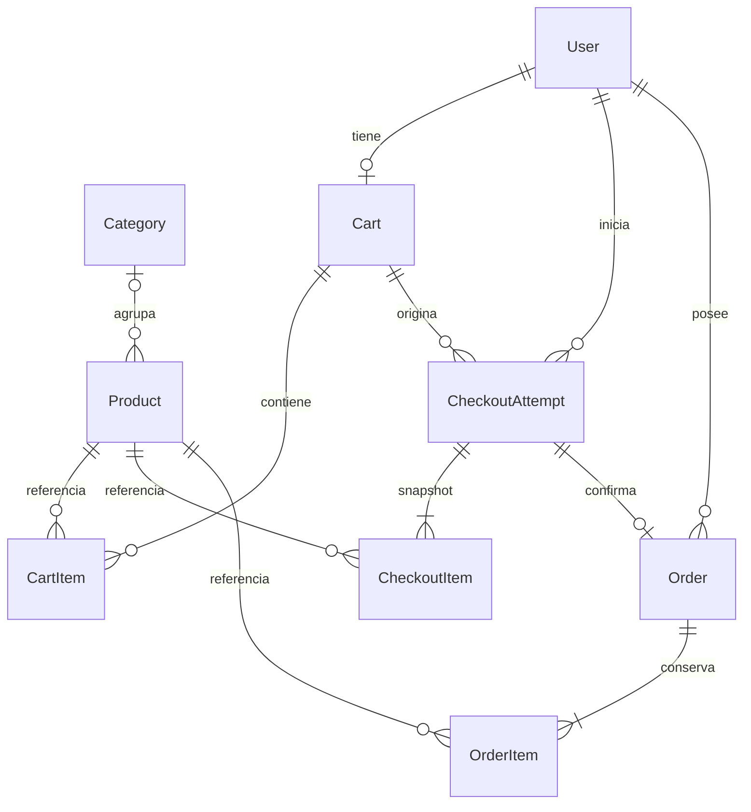

# Arquitectura y modelo de datos

Arquitectura implementada. Actualización: 31 de octubre de 2026.

## Estructura

```text
src/
  app/
    (auth)/                  Login y registro, sin layout de tienda
    (store)/                 Header, menú móvil, sidebar y panel de carrito
      (public)/              Inicio de categorías y detalle de productos
      (authenticated)/       Perfil, resultado de checkout y órdenes propias
      admin/                 Productos y categorías con autorización ADMIN
    api/
      auth/[...all]/          Better Auth existente
      trpc/[trpc]/            API existente
      uploads/products/      Subida de imágenes, solo ADMIN
      webhooks/stripe/        Recepción de eventos con firma verificada
  components/ui/             Primitivas compartidas de la plantilla
  lib/                       Auth, Prisma, clientes y utilidades existentes
  server/
    api/routers/              Procedimientos de catálogo, administración, carrito y órdenes
    payments/        Confirmación transaccional e idempotente de pagos
    integrations/             Clientes de Stripe y S3, exclusivos del servidor
    validation/               Esquemas Zod compartidos cuando corresponde
    db/prisma/                Esquema y migraciones existentes
```

Los componentes específicos de una página permanecen en su carpeta `_components/`, con archivos kebab-case. Las lecturas de Server Components pasan por el caller tRPC; las interacciones cliente usan el cliente React de tRPC. No se crea una capa de repositorios genérica para este alcance.

El proxy sirve para redirecciones de navegación; la cookie por sí sola no autoriza operaciones. Cada procedimiento o handler protegido verifica una sesión válida. Las operaciones ADMIN consultan el rol actual en el backend y no confían en un campo enviado por el navegador.

## Acceso a datos y excepción para Stripe

Se conserva la convención de consultar Prisma dentro de procedimientos tRPC. La excepción de negocio es el servicio de confirmación de pagos, exclusivo del servidor, invocado por el handler de Stripe después de verificar la firma. Allí se realiza la transacción atómica de orden, ítems, intento y carrito.

Este servicio no se registra como procedimiento público ni recibe un indicador `isPaid` desde el frontend. Los componentes de interfaz nunca consultan Prisma directamente. Better Auth y el comando de datos iniciales mantienen el acceso que requieren para autenticar y preparar el entorno.

## Modelo

Se conservan User, Session, Account y Verification de Better Auth. User incorpora el rol CUSTOMER/ADMIN. La tabla heredada ToDoItem permanece sin rutas ni uso en la tienda.

| Entidad         | Campos principales                                                                                                                                 | Restricciones e índices                                                                                        |
| --------------- | -------------------------------------------------------------------------------------------------------------------------------------------------- | -------------------------------------------------------------------------------------------------------------- |
| User            | Campos existentes, role                                                                                                                            | role por defecto CUSTOMER, no editable desde registro; email único existente                                   |
| Category        | id, name, imageKey, createdAt, updatedAt                                                                                                           | Nombre único sin distinguir mayúsculas; portada opcional; productos desasignados al eliminar                   |
| Product         | id, name, description, priceCents, imageKey, active, categoryId, deletedAt, createdAt, updatedAt                                                   | Precio entero positivo, nombre y descripción no vacíos; baja lógica mediante deletedAt, sin destruir historial |
| Cart            | id, userId, version, createdAt, updatedAt                                                                                                          | userId único; version entero que aumenta con cada modificación                                                 |
| CartItem        | id, cartId, productId, quantity                                                                                                                    | Único por cartId/productId; cantidad de 1 a 99                                                                 |
| CheckoutAttempt | id, userId, cartId, cartVersion, requestKey, status, currency, totalCents, stripeSessionId, stripePaymentIntentId, expiresAt, createdAt, updatedAt | Único por userId/requestKey; stripeSessionId y stripePaymentIntentId únicos cuando existen                     |
| CheckoutItem    | id, checkoutAttemptId, productId, productName, unitPriceCents, quantity                                                                            | Único por checkoutAttemptId/productId; snapshot inmutable                                                      |
| Order           | id, userId, checkoutAttemptId, status, currency, totalCents, paidAt, createdAt                                                                     | checkoutAttemptId único; índice userId/createdAt para historial                                                |
| OrderItem       | id, orderId, productId, productName, unitPriceCents, quantity                                                                                      | Único por orderId/productId; snapshot inmutable                                                                |

`imageKey` guarda una referencia como `products/<productId>/<uuid>.webp`, no una URL temporal. Se exige una imagen para publicar un producto activo. Los ítems históricos conservan nombre y precio, sin depender de imágenes que pueden reemplazarse.

Los identificadores son opacos. Las tablas nuevas siguen las convenciones Prisma de la plantilla. Las cantidades, precios y totales se validan en servidor y se respaldan con restricciones CHECK de PostgreSQL en las migraciones. Se limita el total a un rango admitido por los enteros elegidos y por Stripe; se rechaza el exceso antes de crear la sesión.

Las órdenes y sus snapshots no se borran al editar productos. No se agrega eliminación pública de usuarios; las relaciones de órdenes restringen borrados que destruyan historial. El borrado de un carrito elimina sus ítems, pero no sus compras.



## Estados

| Entidad         | Estado  | Significado                                                                            |
| --------------- | ------- | -------------------------------------------------------------------------------------- |
| CheckoutAttempt | PENDING | Intento guardado; sesión por crear, pendiente de pago o resultado de creación incierto |
| CheckoutAttempt | PAID    | Pago verificado y orden persistida                                                     |
| CheckoutAttempt | EXPIRED | Stripe confirmó que expiró la sesión sin pago                                          |
| CheckoutAttempt | FAILED  | Fallo definitivo al preparar el pago; nunca una simple pérdida de conexión             |
| Order           | PAID    | Compra confirmada; único estado necesario en el alcance actual                         |

Rechazar una tarjeta no vuelve FAILED al intento: Stripe puede permitir que el usuario vuelva a intentarlo. Regresar con la URL de cancelación tampoco demuestra que la sesión haya expirado. Un evento tardío no puede degradar una compra PAID a EXPIRED.

## Operaciones

| Módulo           | Operaciones implementadas                                  | Protección                                                   |
| ---------------- | ---------------------------------------------------------- | ------------------------------------------------------------ |
| catalog          | list, byId, suggestions                                    | Solo productos activos; búsqueda y paginación con límites    |
| adminProduct     | list, byId, create, update, setActive, attachImage, remove | adminProcedure con rol actual validado                       |
| cart             | get, count, addItem, setQuantity, removeItem               | protectedProcedure; usuario derivado de sesión               |
| checkout         | start, byId                                                | protectedProcedure; intento propio y precios recalculados    |
| order            | list, byId, suggestions                                    | protectedProcedure; filtro por userId de sesión              |
| uploads/products | POST multipart                                             | Sesión ADMIN, tipo real, tamaño y clave generada en servidor |
| webhooks/stripe  | POST cuerpo sin transformar                                | Firma Stripe válida y entorno de pruebas verificado          |

Las consultas ajenas de órdenes o intentos devolverán NOT_FOUND. No se acepta userId del navegador para decidir el propietario. Los errores de entrada son BAD_REQUEST, sesión ausente UNAUTHORIZED, rol insuficiente FORBIDDEN y carrito/precios cambiados CONFLICT.

## Checkout

1. `cart.get` calcula el resumen en servidor y devuelve `version` y una huella del resumen (productos, cantidades, precios vigentes y moneda). La huella permite detectar una pantalla desactualizada; no autoriza precios del cliente.
2. `checkout.start` recibe la versión esperada, esa huella y una requestKey aleatoria para el intento. En una transacción corta lee carrito y productos, valida activos/cantidades y recalcula el resumen. Si no coincide, exige revisar el carrito actualizado.
3. Guarda CheckoutAttempt y CheckoutItem con nombres, cantidades y precios actuales. La combinación userId/requestKey reconoce reintentos; reutilizarla para otro contenido se rechaza. Repetir una petición devuelve el mismo intento.
4. Fuera de la transacción SQL crea Checkout Session en modo payment, USD y solo tarjetas, usando el ID del intento como clave de idempotencia de Stripe y referencia en metadata. Los importes salen del snapshot persistido.
5. Guarda el identificador y vencimiento de la sesión. Una pérdida de conexión deja un resultado incierto; se recupera con la misma clave, sin crear a ciegas otro cobro. Una sesión vencida requiere un intento nuevo. Pasada la retención de idempotencia de Stripe, se reconcilia el intento antes de repetir una creación.
6. El navegador se redirige a la URL de Stripe. La pantalla de retorno consulta `checkout.byId`, limitado al propietario, y admite el estado pendiente mientras llega el webhook.

La clave de idempotencia evita duplicar una misma operación reintentada. Dos compras iniciadas expresamente con claves diferentes son intentos distintos; no se promete deduplicar compras diferentes por tener los mismos productos.

## Confirmación del pago

1. El handler lee el cuerpo original y verifica `Stripe-Signature` con el secreto local. No parsea y vuelve a serializar el JSON antes de verificarlo.
2. Solo procesa eventos esperados de pruebas. Para una sesión completada, obtiene el estado actual de Stripe y exige `payment_status=paid`; valida session ID, referencia del intento, moneda y total contra PostgreSQL. No consulta el precio actual del producto para alterar un cobro ya realizado.
3. En una transacción crea Order y OrderItem, marca PAID y limpia el carrito solo si su versión todavía coincide con `cartVersion`. La limpieza y el incremento de versión usan una condición atómica; las mutaciones del carrito también deben serializarse sobre esa versión.
4. Si el carrito cambió, se conserva completo y la interfaz informa que la compra se registró pero el carrito fue conservado. No se borran productos agregados durante el pago ni se vuelve a limpiar ante un webhook duplicado.
5. La unicidad de Order.checkoutAttemptId y la actualización transaccional protegen ante eventos repetidos y concurrentes. Si la orden ya existe, se confirma el evento sin recrearla. Si hay un fallo transitorio, se devuelve error para permitir reintento; no se responde éxito antes de persistir la orden.
6. Un evento de expiración actualiza únicamente un intento aún pendiente y no crea una orden. Se comprueba el estado actual de Stripe si existe una carrera con una confirmación de pago.

No se agrega una cola para este volumen: el procesamiento consiste en una consulta corta a Stripe y una transacción breve. No se guardan datos de tarjeta ni claves en la base de datos.

## Referencias de pagos

- [Webhooks, firma y cuerpo original](https://docs.stripe.com/webhooks).
- [Claves de idempotencia y su retención](https://docs.stripe.com/api/idempotent_requests).
- [Configuración local de Stripe](stripe.md).

## Categorías y navegación

`category.list` devuelve páginas de 20 categorías, portada propia o de producto activo y cantidad de productos. `category.navigation` devuelve los enlaces del sidebar sin paginar. `adminCategory` gestiona nombre, portada, asignaciones y eliminación. Quitar un producto lo deja sin categoría; eliminar la categoría no elimina ni desactiva sus productos. Las compras conservan los snapshots.

Las búsquedas de productos calculan primero el conjunto cuyo nombre empieza con la consulta y después las coincidencias internas. El catálogo pagina ambos conjuntos en ese orden, sin duplicados; las sugerencias completan hasta cuatro opciones. Los borradores y las bajas lógicas se excluyen de todas las lecturas públicas.

La subida de portadas usa `POST /api/uploads/categories`. Los archivos se validan y convierten a WebP antes de guardarse en S3. La referencia completa de procedimientos y handlers está en [api.md](api.md).

## Ejecución con Docker Compose

La ejecución local principal usa `compose.yaml`: `prepare` genera secretos persistentes, PostgreSQL espera a esa configuración, `init` aplica migraciones/seed y la aplicación arranca después de su finalización exitosa. La imagen contiene Node 24, Bun 1.2.20, Stripe CLI y el build de Next.js; no copia `.env`, `.aws` ni dependencias del host.

`postgres_data` conserva la base; `runtime_config` conserva contraseñas y configuración privada. `aws_session` conserva la sesión temporal de AWS y permite su actualización dentro de Docker. La autenticación se realiza con el servicio `aws` y `login --remote`; CLI y SDK comparten el volumen `aws_session`, sin montar archivos AWS del host. No se publican las credenciales como archivos estáticos ni se incorporan a las capas de la imagen. Next.js y el listener comparten supervisor para sincronizar el secreto y detenerse juntos ante un fallo.

`compose.database.yaml` permite conservar el modo de desarrollo con Node/Bun en el host; no se ejecuta simultáneamente con la aplicación Docker en los mismos puertos. Ambos archivos mantienen el nombre del proyecto y el volumen de PostgreSQL para no perder datos al cambiar de modo.
